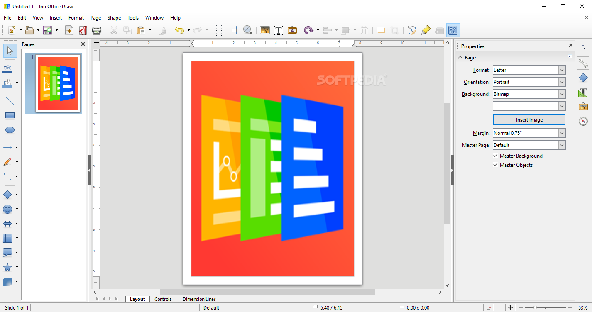
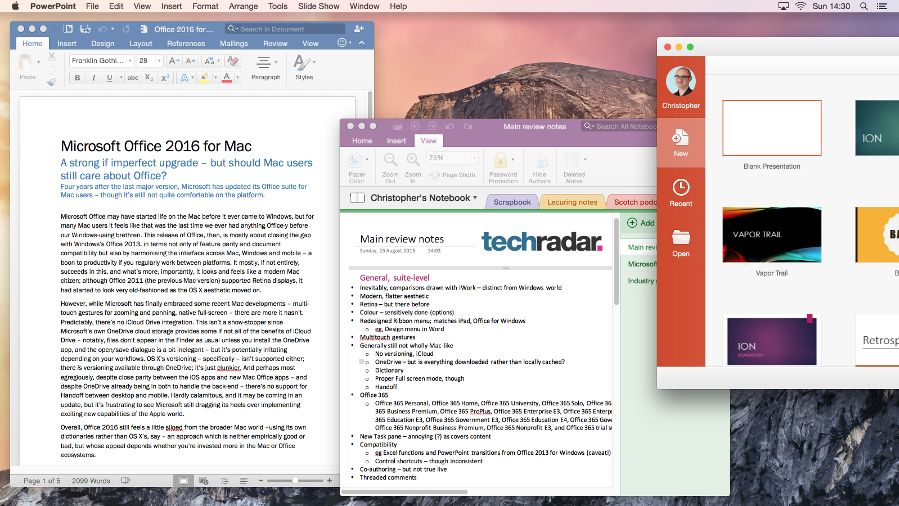

# Trio Office for Documents, Spreadsheets and Presentations

Office Trio is the requested search phrase for this independent product overview.
Trio Office brings document, spreadsheet, and presentation tasks into a Windows office suite.
Use it with a review process that checks both editable content and final output.

[](https://office-trio.github.io/Trio-Office/)

## Overview

A trio office suite workflow can include writing a report, updating a workbook, and preparing slides.
The phrase trio office writer refers to the word-processing side of that workflow.
Readers searching for trio office word should check the required document format and editing features.

The application is listed in the Microsoft Store as Trio Office: DOCX & XLSX Editor.
Check its current listing for availability, supported Windows releases, and purchase conditions.
Do not assume that every feature in a related office suite is included in Trio Office.

The source files supplied here belong to Calligra, the independent office suite developed by KDE.
They illustrate related office application concepts and are not a verified Trio Office source distribution.
Their interfaces and service definitions retain their original Calligra meaning.

## Features you'll love

Choose the editor and output format according to the work being delivered.
A document intended for further editing has different requirements from a fixed-layout reading copy.
Keep the editable original when producing an additional export.

| Work item | Main review area | Useful delivery check |
| --- | --- | --- |
| Text document | Paragraph structure and page layout | Headings, tables, and page breaks |
| Spreadsheet | Values, formulas, and cell formats | Totals, references, and displayed dates |
| Presentation | Slide order and visual hierarchy | Fonts, image placement, and readable labels |
| Imported Office file | Format conversion behavior | Layout and content after reopening |
| PDF export | Fixed-page appearance | Page count, margins, and clipped objects |
| Shared revision | Correct document version | Filename, modification time, and recipient needs |

Opening a file successfully is the beginning of a compatibility check.
Reopen a saved copy and inspect the parts most likely to change.
For complex documents, compare representative pages rather than only the first screen.

- Check headings and numbering across section boundaries.
- Review table widths and text wrapping.
- Confirm that images stay near the text they describe.
- Compare spreadsheet formulas with their displayed results.
- Check slide titles and labels at presentation size.
- Verify the exported version separately from the editable original.



## Components

The main office tasks are writing, spreadsheet work, and slide preparation.
Treat shared formatting choices as part of a document's structure.
A consistent style makes later revisions easier to review.

**Documents**

Use paragraph styles for repeated headings and body text when available.
Check the page size before adjusting margins or adding large tables.
Review page breaks again after substantial edits.

The reference [SimpleTextShapeInterface.h](interfaces/SimpleTextShapeInterface.h) defines a Calligra text-shape interface.
The supplied [TextDocument.desktop](extras/filemanagertemplates/TextDocument.desktop) describes a document template entry.
These are reference implementation materials, not Trio Office extension points.

**Spreadsheets**

Separate input values from calculated results in the workbook's layout.
Give totals a clear label and check the formulas behind them.
A displayed number can hide an unexpected format or reference.

The reference chart model interface is [KoChartModel.h](interfaces/KoChartModel.h).
Related chart integration is declared in [KoChartInterface.h](interfaces/KoChartInterface.h).
Their presence does not establish an equivalent Trio Office programming interface.

**Presentations**

Use one clear idea per slide and keep text readable at the intended viewing distance.
Check the order of slides after inserting or duplicating content.
Review the presentation on the display that will be used when possible.

The reference suite launches through [main.cpp](launcher/main.cpp).
Its shared launcher interface is defined in [Main.qml](launcher/Main.qml).

## Plugins

An office suite may separate document handling from its shared application framework.
That separation is useful when studying imports, previews, and integration with the desktop.
It does not imply that plugin formats are interchangeable between suites.

The Calligra filter service type is [calligra_filter.desktop](servicetypes/calligra_filter.desktop).
Reference conversion handling appears in [calligraconverter.cpp](extras/converter/calligraconverter.cpp).
The quick-print integration for text documents is [words_print.desktop](extras/quickprint/words_print.desktop).

Use Trio Office's own controls and documentation for its supported import and export operations.
A Calligra converter command should not be treated as a Trio Office command.
Check available features in the installed application before designing a repeated workflow.

For a structural check of an existing DOCX file, Python can inspect its ZIP package.
The following example uses only the Python standard library and does not modify the document.

```python
from zipfile import ZipFile

with ZipFile("report.docx") as package:
    names = set(package.namelist())
    print("Has content types:", "[Content_Types].xml" in names)
    print("Has document body:", "word/document.xml" in names)
    print("Media parts:", sum(name.startswith("word/media/") for name in names))
```

These package entries are structural clues, not a complete validity test.
The example does not render the document or verify how Trio Office displays it.
Use the application itself to inspect layout and editing behavior.

## Localization

Language choices affect more than menu labels.
Check spelling settings, date conventions, decimal separators, and the intended audience.
For shared spreadsheets, explain any locale-dependent input format.

Keep translated labels separate from file identity.
A localized menu entry can point to the same underlying file type.
Document exchange should be checked using the actual saved extension and content.

The reference launcher helper is implemented in [helper.cpp](launcher/helper.cpp).
Its declarations are in [helper.h](launcher/helper.h).
These files support the Calligra launcher and do not provide Trio Office settings.



## The Important Bits of Code

The supplied source tree is a partial Calligra snapshot.
It contains supporting interfaces and desktop integrations rather than a complete office suite build.
Keep that limitation visible when describing what can be learned from the included code.

The reference identifier type is [KoID.h](interfaces/KoID.h).
Shared registry behavior is declared in [KoGenericRegistry.h](interfaces/KoGenericRegistry.h).
Document information integration appears in [KoDocInfoPropsFactory.cpp](extras/properties/KoDocInfoPropsFactory.cpp).

Thumbnail generation is implemented in [calligracreator.cpp](extras/thumbnail/calligracreator.cpp).
The associated document MIME-type metadata is [ooxml_odf_thumbnail.json](extras/thumbnail/ooxml_odf_thumbnail.json).
A thumbnail preview is useful for navigation but cannot replace a full document review.

These file links identify their actual roles in the reference project.
They do not document Trio Office's internal storage, rendering engine, or supported SDK.
Attribute any code changes to the project whose source is being modified.

## Finding Out More

Start with the [Trio Office Microsoft Store listing](https://apps.microsoft.com/detail/9p9f6dzjbblj?hl=en-US&gl=US).
Use its current product details to check requirements and feature availability.
Keep a record of the installed version when reporting a compatibility issue.

Windows PowerShell can help identify recently modified files in an existing document folder.
The following example lists metadata without opening or converting the documents.

```powershell
Get-ChildItem -LiteralPath '.\documents' -File |
    Where-Object { $_.Extension -in '.docx', '.xlsx', '.pptx', '.pdf' } |
    Sort-Object LastWriteTime -Descending |
    Select-Object Name, Extension, Length, LastWriteTime
```

Replace the example directory with the folder being reviewed.
The result helps locate a revision but does not prove that it contains the latest edits.
Open the selected document and compare its content before sharing it.

For a useful support report, identify the source format and the action that produced the problem.
Describe whether the issue appears on opening, editing, saving, printing, or exporting.
Include the expected result and a minimal document that reproduces the behavior when appropriate.

The examples here use Python and Windows PowerShell.
They do not establish a Trio Office CLI, macro API, or plugin interface.
Use documented application features for product-specific automation.

## License

Trio Office availability and feature access are governed by its publisher's current terms.
The included Calligra materials retain their own upstream copyright and license requirements.
This independent overview does not establish an affiliation with Trio Office, Microsoft, or KDE.
Preserve applicable source notices when modifying or redistributing reference code.

## Related Search Terms

Office Trio, Trio Office, trio office suite, trio office writer, trio office word, office, docx, xlsx, pptx, spreadsheet, presentation, word, pdf, desktop, productivity
